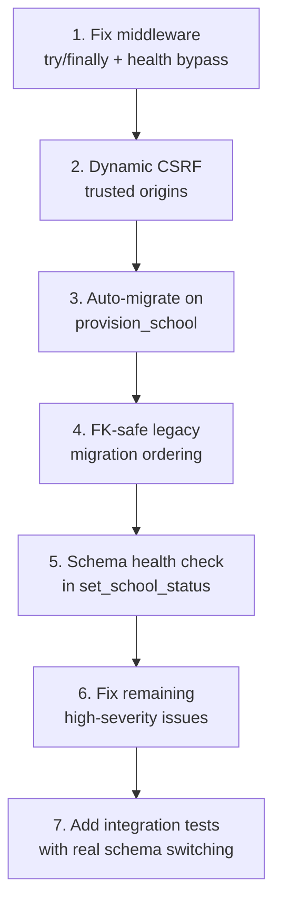

# Multi-Tenancy Implementation Audit

> [!CAUTION]
> **5 critical production blockers** must be fixed before this branch can be merged. Several will cause immediate crashes or data leakage in production.

---

## 🚨 Critical Severity — Production Blockers

### 1. CSRF Origin Failure on All Custom Tenant Domains
**File:** [`production.py`](file:///c:/RebuildEden/project%201/schoolsystem/settings/production.py)

`CSRF_TRUSTED_ORIGINS` is statically read from an environment variable. When a new tenant is provisioned with a custom domain (e.g. `https://atebubu.shs.edu.gh`), that origin is **not** present in the list. Django 4.0+ enforces `Origin` header checking on all HTTPS POST requests.

**Impact:** Every login, exeat form, roll-call update, and configuration POST from a custom tenant domain fails with `403 Forbidden`.

**Fix:** Implement a dynamic CSRF middleware that queries `Domain.objects.filter(domain=origin_host, is_verified=True, tenant__is_active=True).exists()`.

---

### 2. Connection Pool Contamination on Unhandled Exceptions
**File:** [`middleware.py`](file:///c:/RebuildEden/project%201/tenancy/middleware.py)

`VerifiedDomainRoutingMiddleware` uses `MiddlewareMixin` and relies on `process_response` to call `activate_public()`. If a downstream view throws an unhandled exception, `process_response` **never runs**. With `CONN_MAX_AGE = 600`, the persistent connection's PostgreSQL `search_path` stays pinned to the tenant schema.

**Impact:** The next request reusing that connection reads/writes data in the **wrong tenant's schema** — cross-tenant data leakage or corruption.

**Fix:** Convert to new-style middleware with `try...finally`:
```python
class VerifiedDomainRoutingMiddleware:
    def __init__(self, get_response):
        self.get_response = get_response

    def __call__(self, request):
        activate_public()
        set_urlconf(None)
        # ... resolve tenant ...
        activate(tenant)
        try:
            response = self.get_response(request)
        finally:
            activate_public()
            set_urlconf(None)
        return response
```

---

### 3. Provisioned Schools Have Zero Tables
**File:** [`provision_school.py`](file:///c:/RebuildEden/project%201/tenancy/management/commands/provision_school.py)

`Tenant.objects.create()` creates the PostgreSQL schema namespace but **does NOT run migrations**. The README claims *"the schema is created and migrated automatically"* — this is incorrect. Activating a provisioned school immediately exposes visitors to `relation "core_..." does not exist` errors.

**Impact:** Any newly provisioned and activated school returns 500 errors on every request.

**Fix:** Call `call_command('migrate', schema=schema_name)` after schema creation, or at minimum enforce a migration check in `set_school_status --activate`.

---

### 4. Legacy Migration Fails on Foreign Key Violations
**File:** [`migrate_legacy_school.py`](file:///c:/RebuildEden/project%201/tenancy/management/commands/migrate_legacy_school.py)

Tables are sorted **alphabetically** (`sorted(...)`) and the command relies on `SET CONSTRAINTS ALL DEFERRED`. But standard Django foreign keys are created as `NOT DEFERRABLE`, so PostgreSQL checks constraints **immediately** on each INSERT.

**Impact:** `core_attendance` or `core_disciplinaryrecord` is inserted before `core_student` → immediate `ForeignKeyViolation`. The legacy migration command crashes every time on any database with FK-linked data.

**Fix:** Either disable triggers during the copy (`ALTER TABLE ... DISABLE TRIGGER ALL;` per table, re-enable after), or topologically sort tables by FK dependency order.

---

### 5. Health Checks & Platform Admin Completely Locked Out
**File:** [`middleware.py`](file:///c:/RebuildEden/project%201/tenancy/middleware.py)

The middleware unconditionally requires every request's hostname to match a verified, active `Domain` record. Cloud health probes (Render/ALB hitting an IP or default hostname), platform admin endpoints, and any unmapped root domain all return 404.

**Impact:** Render marks the service as unhealthy and restarts it in a loop. Platform operators cannot access admin.

**Fix:** Add a bypass whitelist for health-check paths (`/healthz`, `/live`) and optionally a platform admin domain.

---

## ⚠️ High Severity — Logic & Data Integrity

### 6. Static `CSRF_TRUSTED_ORIGINS` Doesn't Scale
Closely related to Critical #1 — every time a new school domain is added, the environment variable must be manually updated and the service restarted. This is operationally unsustainable.

### 7. Synthetic Pilot Seeder Breaks Under Multi-Tenancy
**File:** [`seed_synthetic_pilot.py`](file:///c:/RebuildEden/project%201/core/management/commands/seed_synthetic_pilot.py)

No `--schema` argument. When `TENANCY_ENABLED=True`, the `TenantAppsRouter` routes core model queries to tenant schemas. Running the seeder against the public schema throws relation errors.

### 8. File Path Double-Prefixing on Resumed Migration
**File:** [`migrate_legacy_school.py`](file:///c:/RebuildEden/project%201/tenancy/management/commands/migrate_legacy_school.py) — `_copy_file()`

If the migration crashes during file sync and is re-run, `old_name` might already start with `tenants/{schema}/`. The code unconditionally prepends again → `tenants/schema/tenants/schema/...`.

**Fix:** Guard with `if old_name.startswith(f"tenants/{schema_name}/"): return old_name`.

### 9. Shared Telco Sender ID Across All Tenants
**File:** [`sms.py`](file:///c:/RebuildEden/project%201/core/services/sms.py)

`SMS_SENDER_ID` is a single global environment variable. All tenant schools' SMS messages arrive on parents' phones under the same header (e.g. "ATSEC"). This is confusing and potentially a regulatory issue.

### 10. `_with_tenant_schema` Swallows the `tenant_schema` Parameter
**File:** [`tasks.py`](file:///c:/RebuildEden/project%201/core/tasks.py)

The decorator consumes `tenant_schema` from kwargs and **never passes it** to the wrapped function. The decorated functions declare `tenant_schema: str | None = None` in their signatures but always receive `None`. Works only because the context manager sets the thread-local schema — but the code is misleading and fragile.

### 11. Multiple Primary Domains Allowed Per Tenant
**File:** [`add_school_domain.py`](file:///c:/RebuildEden/project%201/tenancy/management/commands/add_school_domain.py)

`--primary` doesn't demote existing primary domains for that tenant. A tenant can accumulate multiple `is_primary=True` domains.

### 12. `add_school_domain` Missing `TENANCY_ENABLED` Check
Unlike `provision_school`, this command never checks the flag. If tenancy is disabled, `Domain.save()` raises a raw `ValidationError` traceback instead of a clean `CommandError`.

### 13. `set_school_status --activate` Has No Schema Health Check
Activating a tenant only checks for a verified domain. It never verifies whether the PostgreSQL schema exists or has been migrated. An unmigrated activation → immediate 500s.

---

## 📋 Medium Severity — Edge Cases & Hardening

| # | Issue | File |
|---|---|---|
| 14 | `Tenant.save()` doesn't call `full_clean()` — bypasses `check_schema_name_not_reserved` on programmatic saves | `tenancy/models.py` |
| 15 | `normalize_domain()` raises `ValidationError({"domain": "..."})` — management commands catching it get raw dict string formatting | `tenancy/models.py` |
| 16 | No DB-level regex constraint on `schema_name` — hyphens cause `search_path` SQL syntax errors | `migrations/0001_initial.py` |
| 17 | `tenant_upload_path` crashes with `AttributeError` if `get_current_schema()` returns `None` | `core/models.py` |
| 18 | IPv6 addresses malfunction in middleware — `[::1]:8000` splits on `:` producing `[` | `tenancy/middleware.py` |
| 19 | `provision_school` / `add_school_domain` are not wrapped in `transaction.atomic()` — orphaned schemas on partial failure | Management commands |
| 20 | `migrate_legacy_school` may exceed the 30-second `statement_timeout` on large datasets | `migrate_legacy_school.py` |
| 21 | `TENANTS["public"]` lacks a `URLCONF` definition | `settings/base.py` |
| 22 | `ContentType` is isolated in `PUBLIC_APPS` while `auth.Permission` (which FKs to it) is in `TENANT_APPS` — potential cross-schema FK issues | `settings/base.py` |
| 23 | `django.contrib.staticfiles` appears in both `PUBLIC_APPS` and `TENANT_APPS` | `settings/base.py` |

---

## 🧪 Test Coverage Gaps

- **Zero integration tests** with real PostgreSQL schema switching
- All 3,207 lines in [`core/tests.py`](file:///c:/RebuildEden/project%201/core/tests.py) assume single-tenant mode
- [`test_tenants.py`](file:///c:/RebuildEden/project%201/tenancy/test_tenants.py) is 100% mock-based — no live DB schema validation
- Running `manage.py test` with `TENANCY_ENABLED=True` will likely **break the entire existing test suite** because `TestCase` creates tables in the public schema while `TenantAppsRouter` routes queries to tenant schemas

---

## 📝 Documentation Inaccuracies

| Location | Claim | Reality |
|---|---|---|
| README §Multi-school tenancy | *"The schema is created and migrated automatically"* | Only the schema namespace is created; migrations are NOT run |
| README §Existing-school cutover | Implies `migrate_legacy_school` works end-to-end | FK violation on alphabetical table copy breaks it |

---

## Recommended Fix Priority



> [!IMPORTANT]
> Issues 1–5 are **must-fix before merge**. The middleware connection leak (#2) is the most dangerous — it can silently serve one school's data to another school's users.
