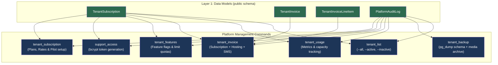
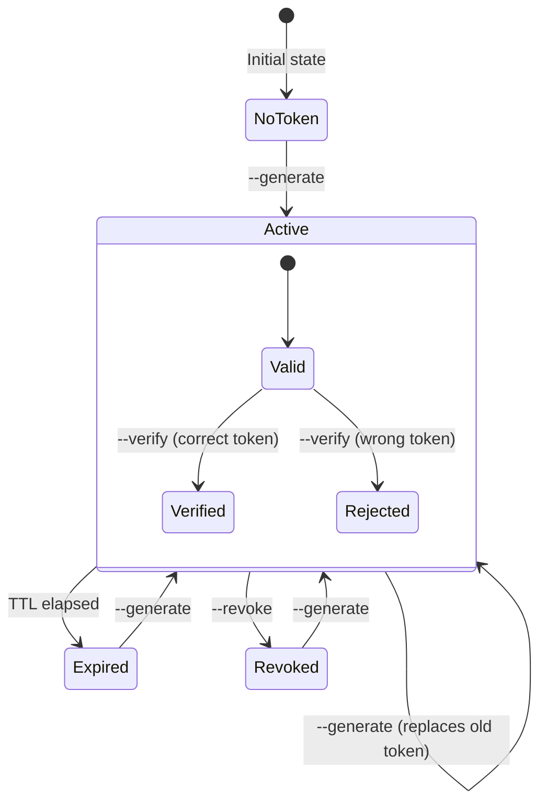
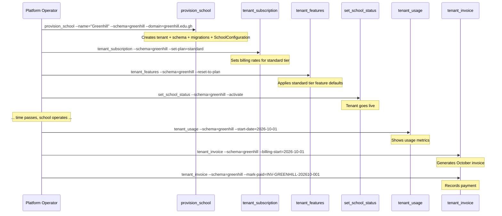

# Platform CLI Management Commands — Implementation Plan

> [!IMPORTANT]
> This plan covers **6 layers** of work that build on each other sequentially.
> No layer should be implemented until the previous layer is complete and verified.
> All new models live in the **public schema** (via `tenancy/` app in `PUBLIC_APPS`).
> All commands live in `tenancy/management/commands/`.

---

## Architecture Overview



---

## Terminal Color Code Reference

All commands use Django's built-in style helpers plus ANSI escapes for extended formatting:

| Color / Style | Django Helper | ANSI Code | Usage |
|---|---|---|---|
| 🟢 Green | `self.style.SUCCESS()` | `\033[92m` | Healthy metrics, enabled features, successful operations |
| 🔴 Red | `self.style.ERROR()` | `\033[91m` | Exceeded limits, disabled features, errors, critical warnings |
| 🟡 Yellow | `self.style.WARNING()` | `\033[93m` | Approaching limits (>80%), pending states, caution notices |
| 🔵 Cyan | `self.style.NOTICE()` | `\033[96m` | Headers, section dividers, informational labels |
| ⚪ Bold | — | `\033[1m` | Table headers, command titles, key values |
| ⚪ Dim | — | `\033[2m` | Timestamps, secondary info, audit trail metadata |
| ⚪ Reset | — | `\033[0m` | Reset after every styled block |

> [!TIP]
> When `--json` is passed, **all color output is suppressed** and a machine-readable JSON object is written to stdout. This enables scripting and CI/CD integration.

---

## Shared Patterns (All Commands)

### Guard Clauses (every command's `handle()` starts with these)

```python
def handle(self, *args, **options):
    if not settings.TENANCY_ENABLED:
        raise CommandError(
            "Set TENANCY_ENABLED=true before using platform management commands."
        )
```

### Tenant Lookup Helper

```python
def _resolve_tenant(self, schema_name: str) -> Tenant:
    """Look up a tenant by schema name or raise CommandError."""
    tenant = Tenant.objects.filter(schema_name=schema_name).first()
    if tenant is None:
        raise CommandError(f"Tenant schema '{schema_name}' was not found.")
    return tenant
```

### Audit Logging Helper

```python
def _audit(self, *, action: str, schema: str, detail: str, operator: str = "cli"):
    """Write an entry to PlatformAuditLog."""
    PlatformAuditLog.objects.create(
        action=action,
        tenant_schema=schema,
        detail=detail,
        operator=operator,
    )
```

### JSON Output Helper

```python
def _output(self, data: dict, *, json_mode: bool):
    """Print data as JSON or formatted text."""
    if json_mode:
        import json
        self.stdout.write(json.dumps(data, indent=2, default=str))
    else:
        # Each command implements its own rich-text formatter
        self._print_rich(data)
```

---

## Layer 1: Data Models

**Files to create/modify:**
- `tenancy/models.py` — add 3 new models below existing `Tenant` and `Domain`
- `tenancy/migrations/0004_platform_billing_models.py` — auto-generated migration

### 1.1 `TenantSubscription` Model

One-to-one relationship with `Tenant`. Stores the plan tier, pricing rates, feature flags, and support token configuration.

```python
class PlanTier(models.TextChoices):
    """Available subscription plan tiers."""
    FREE = "free", "Free / Trial"
    STARTER = "starter", "Starter"
    STANDARD = "standard", "Standard"
    PREMIUM = "premium", "Premium"
    PILOT = "pilot", "Pilot (Atebubu SHS)"
    ENTERPRISE = "enterprise", "Enterprise"


class BillingCycle(models.TextChoices):
    """Billing frequency."""
    TERMLY = "termly", "Termly (3 terms/year)"
    MONTHLY = "monthly", "Monthly"


class TenantSubscription(models.Model):
    """
    Platform-level subscription configuration for a tenant.

    Stores billing rates, plan tier, feature entitlements, termly configuration,
    and support access configuration. Lives in the public schema because it
    relates to the Tenant model (also public).

    Calculation for a standard 3-month term:
        Term Fee = Base Fee + (Students × Rate per student month × Months in term)
        e.g. Standard tier for 1,500 students:
          1,000 + (1,500 × 0.65 × 3) = GH₵3,925 / term

        Pilot agreement (Atebubu SHS):
          Flat GH₵2,500 / term for up to 2,000 students (is_pilot_flat_fee=True)
    """
    tenant = models.OneToOneField(
        "tenancy.Tenant",
        on_delete=models.CASCADE,
        related_name="subscription",
    )
    plan_tier = models.CharField(
        max_length=20,
        choices=PlanTier.choices,
        default=PlanTier.FREE,
        help_text="Current subscription plan tier.",
    )
    billing_cycle = models.CharField(
        max_length=10,
        choices=BillingCycle.choices,
        default=BillingCycle.TERMLY,
        help_text="Billing frequency (termly or monthly).",
    )
    months_per_term = models.PositiveSmallIntegerField(
        default=3,
        help_text="Number of months per academic term for billing calculations (default 3).",
    )

    # Termly Billing rates (all in GHS)
    base_fee = models.DecimalField(
        max_digits=10, decimal_places=2, default=1000.00,
        help_text="Base platform fee per term (e.g. GH₵500 Starter, GH₵1,000 Standard, GH₵2,000 Premium).",
    )
    rate_per_student_month = models.DecimalField(
        max_digits=8, decimal_places=2, default=0.65,
        help_text="Monthly rate per student (e.g. GH₵0.50 Starter, GH₵0.65 Standard, GH₵0.80 Premium).",
    )

    # Pilot agreement override (Atebubu SHS)
    is_pilot_flat_fee = models.BooleanField(
        default=False,
        help_text="If True, charges pilot_flat_amount per term regardless of student formula.",
    )
    pilot_flat_amount = models.DecimalField(
        max_digits=10, decimal_places=2, default=2500.00,
        help_text="Flat fee per term for pilot agreement (default GH₵2,500 for Atebubu SHS).",
    )

    # Cloud Infrastructure Cost-basis & Margin model (Render + Neon)
    include_hosting_fee = models.BooleanField(
        default=True,
        help_text="Whether to itemize Render + Neon hosting fees on the invoice.",
    )
    infra_cost_basis_monthly = models.DecimalField(
        max_digits=10, decimal_places=2, default=150.00,
        help_text=(
            "Tenant's monthly infrastructure cost basis in GHS. "
            "Platform hosting total is ~GH₵430/mo ($37 USD). For shared multi-tenant, "
            "default is GH₵150.00/mo (or GH₵430.00 for dedicated single-tenant)."
        ),
    )
    infra_margin_percent = models.DecimalField(
        max_digits=5, decimal_places=2, default=15.00,
        help_text="Service markup percentage applied to hosting cost basis (e.g. 15.00 for 15%).",
    )

    # SMS Cost-basis & Margin model (SMSOnlineGH tiered packages)
    sms_cost_basis = models.DecimalField(
        max_digits=6, decimal_places=5, default=0.02620,
        help_text=(
            "Unit provider cost per SMS (B/Q from SMSOnlineGH package). "
            "Default GH₵0.02620 corresponds to the GH₵500 (19,083 credits) tier."
        ),
    )
    sms_margin_percent = models.DecimalField(
        max_digits=5, decimal_places=2, default=15.00,
        help_text="Service markup percentage applied to SMS cost basis (e.g. 15.00 for 15%).",
    )
    rate_per_sms = models.DecimalField(
        max_digits=6, decimal_places=4, default=0.0301,
        help_text=(
            "Effective charge per SMS message sent to school. Computed as "
            "sms_cost_basis * (1 + sms_margin_percent / 100), or overridden manually."
        ),
    )
    currency = models.CharField(
        max_length=3, default="GHS",
        help_text="ISO 4217 currency code (e.g. GHS, USD, NGN).",
    )

    # Feature entitlements — flexible JSON for evolving requirements.
    features = models.JSONField(
        default=dict, blank=True,
        help_text=(
            "Feature flags and limits. Keys: sms_dispatch (bool), "
            "student_id_cards (bool), roster_import (bool), "
            "exeat_gate (bool), advanced_reports (bool), "
            "max_students (int), max_staff (int), max_dormitories (int)."
        ),
    )

    # Support access token (hashed, with expiration).
    support_token_hash = models.CharField(
        max_length=128, blank=True, default="",
        help_text="bcrypt hash of the current support access token.",
    )
    support_token_expires_at = models.DateTimeField(
        null=True, blank=True,
        help_text="Expiration timestamp for the support access token.",
    )
    support_token_granted_by = models.CharField(
        max_length=150, blank=True, default="",
        help_text="Operator who last granted support access.",
    )

    # Timestamps
    created_at = models.DateTimeField(auto_now_add=True)
    updated_at = models.DateTimeField(auto_now=True)

    class Meta:
        verbose_name = "tenant subscription"
        verbose_name_plural = "tenant subscriptions"

    def __str__(self):
        return f"{self.tenant.name} ({self.plan_tier})"

    @property
    def is_support_token_valid(self) -> bool:
        """Check if a support token exists and hasn't expired."""
        if not self.support_token_hash:
            return False
        if self.support_token_expires_at is None:
            return False
        return timezone.now() < self.support_token_expires_at


**Commercial Plan Limits & Features**:

| Feature / Limit Key | Free / Trial | Starter | Standard | Premium | Pilot (Atebubu SHS) | Enterprise |
|---|---|---|---|---|---|---|
| **Base Fee / Term** | GH₵0 | **GH₵500** | **GH₵1,000** | **GH₵2,000** | **GH₵2,500 flat** | Custom |
| **Student / Month** | GH₵0 | **GH₵0.50** | **GH₵0.65** | **GH₵0.80** | **Included** | Negotiated |
| `max_students` | 50 | 500 | 1,500 | 2,500 | 2,000 | ∞ |
| `max_staff` | 5 | 10 | 40 | 75 | 40 | ∞ |
| `max_dormitories` | 2 | 10 | 40 | 60 | 40 | ∞ |
| `roll_call` | ✅ | ✅ | ✅ | ✅ | ✅ | ✅ |
| `exeat_gate` | ❌ | ❌ (Basic) | ✅ Full | ✅ Full | ✅ Full | ✅ Full |
| `student_id_cards` | ❌ | ❌ (Basic) | ✅ QR ID | ✅ QR ID | ✅ QR ID | ✅ QR ID |
| `sms_dispatch` | ❌ | ❌ | ✅ | ✅ | ✅ | ✅ |
| `advanced_reports` | ❌ | ❌ (Basic) | ❌ (Detailed) | ✅ Advanced | ✅ Standard | ✅ Custom |

### 1.2 `TenantInvoice` + `TenantInvoiceLineItem` Models

```python
class InvoiceStatus(models.TextChoices):
    DRAFT = "draft", "Draft"
    ISSUED = "issued", "Issued"
    PAID = "paid", "Paid"
    OVERDUE = "overdue", "Overdue"
    CANCELLED = "cancelled", "Cancelled"


class TenantInvoice(models.Model):
    """
    A generated invoice for a tenant's billing period.

    Invoice numbers follow the format: INV-{SCHEMA}-{YYYYMM}-{SEQ}
    e.g. INV-GREENHILL-202610-001

    Example:
        >>> inv = TenantInvoice.objects.filter(
        ...     tenant__schema_name="greenhill",
        ...     billing_period_start__month=10,
        ... ).first()
        >>> inv.total_amount
        Decimal('1250.00')
    """
    tenant = models.ForeignKey(
        "tenancy.Tenant",
        on_delete=models.CASCADE,
        related_name="invoices",
    )
    invoice_number = models.CharField(
        max_length=50, unique=True,
        help_text="Auto-generated invoice number (INV-SCHEMA-YYYYMM-SEQ).",
    )
    status = models.CharField(
        max_length=20,
        choices=InvoiceStatus.choices,
        default=InvoiceStatus.DRAFT,
    )

    # Billing period
    billing_period_start = models.DateField()
    billing_period_end = models.DateField()

    # Amounts
    subtotal = models.DecimalField(max_digits=12, decimal_places=2, default=0)
    tax_amount = models.DecimalField(max_digits=10, decimal_places=2, default=0)
    total_amount = models.DecimalField(max_digits=12, decimal_places=2, default=0)
    currency = models.CharField(max_length=3, default="GHS")

    # Snapshot of plan at invoice time
    plan_tier_snapshot = models.CharField(max_length=20, default="free")

    # Payment tracking
    paid_at = models.DateTimeField(null=True, blank=True)
    payment_reference = models.CharField(max_length=200, blank=True, default="")
    notes = models.TextField(blank=True, default="")

    # Timestamps
    created_at = models.DateTimeField(auto_now_add=True)
    updated_at = models.DateTimeField(auto_now=True)

    class Meta:
        ordering = ["-billing_period_start"]
        verbose_name = "tenant invoice"

    def __str__(self):
        return self.invoice_number


class TenantInvoiceLineItem(models.Model):
    """Individual line item on a tenant invoice."""
    invoice = models.ForeignKey(
        TenantInvoice,
        on_delete=models.CASCADE,
        related_name="line_items",
    )
    description = models.CharField(max_length=255)
    quantity = models.DecimalField(max_digits=10, decimal_places=2, default=1)
    unit_price = models.DecimalField(max_digits=10, decimal_places=4, default=0)
    line_total = models.DecimalField(max_digits=12, decimal_places=2, default=0)
    category = models.CharField(
        max_length=30, default="base",
        help_text="Category: base, students, sms, addon.",
    )

    class Meta:
        ordering = ["id"]

    def __str__(self):
        return f"{self.description}: {self.line_total}"
```

### 1.3 `PlatformAuditLog` Model

```python
class PlatformAuditLog(models.Model):
    """
    Immutable audit trail for all platform-level CLI operations.

    Every management command that modifies tenant state (subscription,
    features, invoices, support tokens, activation/deactivation) logs
    an entry here.

    Example:
        >>> PlatformAuditLog.objects.filter(
        ...     tenant_schema="greenhill",
        ...     action="feature_toggle",
        ... ).order_by("-timestamp")[:5]
    """
    timestamp = models.DateTimeField(auto_now_add=True, db_index=True)
    action = models.CharField(
        max_length=50, db_index=True,
        help_text=(
            "Action identifier: usage_report, invoice_generate, "
            "invoice_mark_paid, feature_toggle, feature_set_limit, "
            "support_token_generate, support_token_revoke, "
            "subscription_update, tenant_activate, tenant_deactivate."
        ),
    )
    tenant_schema = models.CharField(
        max_length=63, db_index=True,
        help_text="Schema name of the affected tenant.",
    )
    detail = models.TextField(
        help_text="Human-readable description of what changed.",
    )
    operator = models.CharField(
        max_length=150, default="cli",
        help_text="Who performed the action (cli, operator name, system).",
    )
    metadata = models.JSONField(
        default=dict, blank=True,
        help_text="Machine-readable context (old/new values, parameters).",
    )

    class Meta:
        ordering = ["-timestamp"]
        verbose_name = "platform audit log"
        verbose_name_plural = "platform audit logs"
        # Prevent accidental deletion of audit records.
        default_permissions = ("add", "view")

    def __str__(self):
        return f"[{self.timestamp:%Y-%m-%d %H:%M}] {self.action} on {self.tenant_schema}"
```

### Layer 1 Checklist

- [ ] Add `PlanTier`, `TenantSubscription`, `InvoiceStatus`, `TenantInvoice`, `TenantInvoiceLineItem`, `PlatformAuditLog` to `tenancy/models.py`
- [ ] Run `python manage.py makemigrations tenancy` → produces `0004_platform_billing_models.py`
- [ ] Run `python manage.py migrate` (public schema)
- [ ] Verify: `python manage.py shell -c "from tenancy.models import TenantSubscription; print('OK')"`
- [ ] Add `bcrypt` to `requirements.txt` (for support token hashing in Layer 5)

### Layer 1 Dependencies

- None — this is the foundation layer.

---

## Layer 2: `tenant_list` Command

**File:** `tenancy/management/commands/tenant_list.py`

### Purpose

List and inspect all school tenants registered on the platform, with status filters (`--all`, `--active`, `--inactive`), plan tier indicators, enrolled student headcounts, and verified domain routing details.

### Arguments

| Argument | Type | Required | Default | Description |
|---|---|---|---|---|
| `--all` | `flag` | No | True (default) | List all registered tenants |
| `--active` | `flag` | No | — | Filter to active tenants only (`is_active=True`) |
| `--inactive` | `flag` | No | — | Filter to inactive tenants only (`is_active=False`) |
| `--plan` | `str` | No | — | Filter by plan tier (`free/starter/standard/premium/pilot/enterprise`) |
| `--json` | `flag` | No | — | Output machine-readable JSON |
| `--operator` | `str` | No | `"cli"` | Operator name for audit log |

### Terminal Output Example (`manage.py tenant_list`)

```
╔══════════════════════════════════════════════════════════════════════════════════════════╗
║  EDEN SYS — REGISTERED SCHOOL TENANTS                                                   ║
║  Filter: All tenants  │  Platform: Active                                                ║
╚══════════════════════════════════════════════════════════════════════════════════════════╝

Schema          School Name               Primary Domain             Plan       Students  Status
─────────────── ───────────────────────── ────────────────────────── ────────── ───────── ──────
atebubu_shs     Atebubu Senior High       atebubu.edensys.online     pilot      1,420     ✓ ACTIVE   ← GREEN
greenhill       Greenhill Academy         greenhill.edensys.online   standard   850       ✓ ACTIVE   ← GREEN
stmary_shs      St. Mary's Girls SHS      stmary.edensys.online      starter    310       ✓ ACTIVE   ← GREEN
demo_dorm       Demo Boarding School      demo.edensys.online        free       45        ✗ INACTIVE ← RED
─────────────── ───────────────────────── ────────────────────────── ────────── ───────── ──────
TOTALS          4 registered schools                                            2,625 students

Platform Summary: 3 active  │  1 inactive  │  1 pilot agreement
Generated: 2026-10-15 22:58:00 UTC
```

---

## Layer 3: `tenant_backup` Command

**File:** `tenancy/management/commands/tenant_backup.py`

### Purpose

Safely export a single tenant or all tenants' PostgreSQL schemas and associated media files. Generates compressed `.dump` files via `pg_dump`, computes SHA-256 integrity checksums, and creates a companion media archive.

### Arguments

| Argument | Type | Required | Default | Description |
|---|---|---|---|---|
| `--schema` | `str` | No¹ | — | Target tenant schema name |
| `--all` | `flag` | No¹ | — | Sequentially back up all active tenants |
| `--output-dir` | `str` | No | `.private/backups/tenants/` | Directory where backup files will be saved |
| `--format` | `str` | No | `custom` | Dump format: `custom` (`pg_dump -F c`) or `sql` |
| `--include-media` | `flag` | No | — | Also archive tenant's uploads/photos into `.tar.gz` |
| `--verify` | `flag` | No | — | Verify generated dump archive header after export |
| `--operator` | `str` | No | `"cli"` | Operator name for audit log |
| `--json` | `flag` | No | — | Output machine-readable JSON |

¹ One of `--schema` or `--all` is required.

### Backup Process Flow & Integrity Check

```
1. Resolve target tenant & verify schema exists in PostgreSQL
2. Create output directory: .private/backups/tenants/<schema_name>/
3. Execute pg_dump:
   pg_dump -h <host> -U <user> -d <dbname> --schema=<schema> -F c -b -f <backup_file>
4. Calculate SHA-256 hash -> write <backup_file>.sha256
5. If --include-media:
   Archive media/tenants/<schema>/ to <schema>_media_<timestamp>.tar.gz
6. Log PlatformAuditLog(action="tenant_backup", schema=schema)
```

### Terminal Output Example (`manage.py tenant_backup --schema=atebubu_shs --include-media`)

```
╔══════════════════════════════════════════════════════════════╗
║  TENANT BACKUP IN PROGRESS                                   ║
║  Schema: atebubu_shs (Atebubu Senior High School)            ║
╚══════════════════════════════════════════════════════════════╝

  [1/3] Exporting PostgreSQL schema 'atebubu_shs'…
        ✓ Database dump created:                                       ← GREEN
          .private/backups/tenants/atebubu_shs/atebubu_shs_20261015_225800.dump (4.2 MB)

  [2/3] Generating SHA-256 checksum…
        ✓ Checksum verified: 8f2b3e41...a91c                           ← GREEN

  [3/3] Archiving tenant media files…
        ✓ Media archive created:                                       ← GREEN
          .private/backups/tenants/atebubu_shs/atebubu_shs_media_20261015_225800.tar.gz (18.6 MB)

  ─────────────────────────────────────────────────────────────
  Backup completed in 3.4s. 0 errors.
  Audit logged as 'tenant_backup' by operator 'cli'

  To restore this tenant schema:
    pg_restore -h localhost -U postgres -d schoolsystem_db \
        --clean --if-exists -v \
        .private/backups/tenants/atebubu_shs/atebubu_shs_20261015_225800.dump
```

---

## Layer 4: `tenant_usage` Command

**File:** `tenancy/management/commands/tenant_usage.py`

### Purpose

Aggregate and display usage metrics for one or all tenants by querying each tenant's schema dynamically. Metrics include student counts, staff accounts, SMS deliveries, exeat requests, student ID exports, and estimated storage consumption.

### Arguments

| Argument | Type | Required | Default | Description |
|---|---|---|---|---|
| `--schema` | `str` | No¹ | — | Target tenant schema name |
| `--all` | `flag` | No¹ | — | Report on all active tenants |
| `--start-date` | `str` | No | 30 days ago | Start of reporting period (`YYYY-MM-DD`) |
| `--end-date` | `str` | No | today | End of reporting period (`YYYY-MM-DD`) |
| `--json` | `flag` | No | — | Output as JSON |
| `--operator` | `str` | No | `"cli"` | Operator name for audit log |

¹ One of `--schema` or `--all` is required (mutually exclusive group).

### Metrics Collected (per tenant schema)

```python
METRICS = {
    "enrolled_students": "Student.objects.filter(enrollment_status='ENROLLED').count()",
    "total_students": "Student.objects.count()",
    "staff_accounts": "User.objects.filter(is_staff=True).count()",
    "dormitories": "Dormitory.objects.count()",
    "sms_sent": "SMSDelivery.objects.filter(status='DELIVERED', created_at__range=...).count()",
    "sms_failed": "SMSDelivery.objects.filter(status='FAILED', created_at__range=...).count()",
    "sms_queued": "SMSDelivery.objects.filter(status='QUEUED').count()",
    "exeat_requests": "Exeat.objects.filter(created_at__range=...).count()",
    "id_exports": "StudentIDExport.objects.filter(created_at__range=...).count()",
    "roll_call_sessions": "RollCallSession.objects.filter(created_at__range=...).count()",
}
```

### Terminal Output Example (single tenant)

```
╔══════════════════════════════════════════════════════════════╗
║  TENANT USAGE REPORT                                        ║
║  Schema: greenhill  │  Plan: Standard  │  Status: Active     ║
║  Period: 2026-09-15 → 2026-10-15                             ║
╚══════════════════════════════════════════════════════════════╝

  STUDENTS
  ├─ Enrolled:        1,250 / 1,500    ████████████████░░░░  83%   ← YELLOW
  ├─ Total records:   1,310
  └─ Status:          ✓ Within limit                               ← GREEN

  STAFF
  ├─ Active accounts: 32 / 40          ████████████████░░░░  80%   ← YELLOW
  └─ Status:          ✓ Within limit                               ← GREEN

  DORMITORIES
  ├─ Configured:      24 / 40          ████████████░░░░░░░░  60%   ← GREEN
  └─ Status:          ✓ Within limit                               ← GREEN

  SMS (last 30 days)
  ├─ Delivered:       1,247                                        ← GREEN
  ├─ Failed:          23               (1.8% failure rate)         ← YELLOW
  ├─ Queued:          5                                            ← CYAN
  ├─ Cost basis:      GHS 32.67        (1,247 × GH₵0.02620/msg)    ← DIM
  ├─ Markup / Margin: +15.0%                                       ← DIM
  └─ Billed amount:   GHS 37.57        (1,247 × GH₵0.03013/msg)    ← GREEN

  INFRASTRUCTURE (Render + Neon)
  ├─ Allocated basis: GHS 150.00 /mo   (~US$12.88 /mo)             ← DIM
  ├─ Markup / Margin: +15.0%                                       ← DIM
  └─ Billed hosting:  GHS 172.50 /mo                               ← GREEN

  OPERATIONS (last 30 days)
  ├─ Exeat requests:  89
  ├─ ID card exports: 3
  └─ Roll calls:      142

  ─────────────────────────────────────────────────────────────
  Report generated: 2026-10-15 21:05:12 UTC
  Operator: admin
```

### Terminal Output Example (`--all` summary table)

```
PLATFORM USAGE SUMMARY — 2026-09-15 → 2026-10-15
═══════════════════════════════════════════════════════════════════════════

Schema          Plan       Students   Staff   SMS Sent  SMS Failed  Status
─────────────── ────────── ────────── ─────── ───────── ────────── ──────
greenhill       standard   347/500    28/50   1,247     23          ✓      ← GREEN
stmary          starter    189/200    18/20   456       12          ⚠      ← YELLOW (>80%)
westlands       premium    1,205/2000 95/200  3,891     41          ✓      ← GREEN
demo_school     free       52/50      6/5     0         0           ✗      ← RED (exceeded)
─────────────── ────────── ────────── ─────── ───────── ────────── ──────
TOTALS                     1,793      147     5,594     76

4 tenants  │  1 warning  │  1 exceeded limit
Generated: 2026-10-15 21:05:12 UTC
```

### Color Logic

```python
def _usage_color(current: int, limit: int | None) -> str:
    """Return the appropriate style method based on usage percentage."""
    if limit is None or limit == 0:
        return "SUCCESS"  # No limit = always green
    ratio = current / limit
    if ratio >= 1.0:
        return "ERROR"     # Red: exceeded
    elif ratio >= 0.8:
        return "WARNING"   # Yellow: approaching limit
    else:
        return "SUCCESS"   # Green: healthy
```

### Error Handling

| Scenario | Behavior |
|---|---|
| `--schema` not found | `CommandError("Tenant schema 'xyz' was not found.")` |
| Tenant is inactive | Show warning banner: `⚠ Tenant 'xyz' is INACTIVE` but still show metrics |
| Schema exists in DB but has no tables | `CommandError("Schema 'xyz' has not been migrated.")` |
| Invalid date format | `CommandError("Invalid date format 'xyz'. Use YYYY-MM-DD.")` |
| `--start-date` > `--end-date` | `CommandError("Start date must be before end date.")` |
| No subscription record exists | Auto-create a `TenantSubscription` with `FREE` tier defaults |
| Database connection error during schema query | Log error, skip tenant, continue with `--all` |

### Audit Logging

Every invocation logs to `PlatformAuditLog`:

```python
self._audit(
    action="usage_report",
    schema=schema_name,  # or "all" for --all
    detail=f"Usage report generated for period {start} to {end}",
    operator=options.get("operator", "cli"),
)
```

---

## Layer 5: `tenant_invoice` Command

**File:** `tenancy/management/commands/tenant_invoice.py`

### Purpose

Calculate billing amounts based on usage metrics + subscription rates, generate and persist invoice records, optionally render PDF invoices, and manage invoice payment status.

### Arguments

| Argument | Type | Required | Default | Description |
|---|---|---|---|---|
| `--schema` | `str` | Yes | — | Target tenant schema name |
| `--billing-start` | `str` | No | 1st of current month | Billing period start (`YYYY-MM-DD`) |
| `--billing-end` | `str` | No | Last day of current month | Billing period end (`YYYY-MM-DD`) |
| `--generate-pdf` | `flag` | No | — | Generate a PDF invoice file |
| `--output` | `str` | No | `.private/invoices/` | Output directory for PDF files |
| `--mark-paid` | `str` | No | — | Mark invoice as paid (pass invoice number) |
| `--payment-ref` | `str` | No | — | Payment reference (used with `--mark-paid`) |
| `--list` | `flag` | No | — | List all invoices for this tenant |
| `--show` | `str` | No | — | Show details of a specific invoice number |
| `--cancel` | `str` | No | — | Cancel a draft/issued invoice |
| `--json` | `flag` | No | — | Output as JSON |
| `--operator` | `str` | No | `"cli"` | Operator name for audit log |

### Invoice Calculation Logic

```python
def _calculate_invoice(self, tenant, subscription, start_date, end_date):
    """
    Calculate invoice amounts by querying the tenant's schema.

    Returns:
        dict with line_items list and totals.

    Calculation for a standard term (default 3 months):
        Term fee = Base fee + (Students × Rate per student month × Months in term)
        e.g., Standard tier with 1,500 students:
          Base fee: GH₵1,000.00
          Students: 1,500 × GH₵0.65 × 3 months = GH₵2,925.00
          Subscription total = GH₵3,925.00 / term

        Special Pilot Agreement (Atebubu SHS):
          If subscription.is_pilot_flat_fee is True:
            Flat fee = GH₵2,500.00 / term (up to 2,000 students)

        SMS charges (billed separately):
          SMS charge = Messages sent × sms_cost_basis × (1 + sms_margin_percent / 100)
    """
    with tenant:
        enrolled = Student.objects.filter(
            enrollment_status=EnrollmentStatus.ENROLLED
        ).count()
        sms_sent = SMSDelivery.objects.filter(
            status=SMSDelivery.Status.DELIVERED,
            created_at__date__range=(start_date, end_date),
        ).count()

    line_items = []

    # 1. Base / Subscription charge
    if subscription.is_pilot_flat_fee:
        line_items.append({
            "description": f"Pilot Agreement Flat Subscription ({subscription.tenant.name})",
            "quantity": 1,
            "unit_price": subscription.pilot_flat_amount,
            "line_total": subscription.pilot_flat_amount,
            "category": "base",
        })
    else:
        # Standard termly base fee
        line_items.append({
            "description": f"Base platform fee ({subscription.plan_tier.capitalize()} tier / term)",
            "quantity": 1,
            "unit_price": subscription.base_fee,
            "line_total": subscription.base_fee,
            "category": "base",
        })

        # Student charge = enrolled * rate_per_student_month * months_per_term
        months = Decimal(subscription.months_per_term or 3)
        rate_mo = subscription.rate_per_student_month
        term_student_rate = (rate_mo * months).quantize(Decimal("0.01"))
        student_total = (Decimal(enrolled) * term_student_rate).quantize(Decimal("0.01"))

        line_items.append({
            "description": (
                f"Student enrollment ({enrolled} students @ GH₵{rate_mo:.2f}/mo × {months} months)"
            ),
            "quantity": enrolled,
            "unit_price": term_student_rate,
            "line_total": student_total,
            "category": "students",
        })

    # 2. Cloud Infrastructure & Database Hosting (Render + Neon)
    if subscription.include_hosting_fee and subscription.infra_cost_basis_monthly > 0:
        months = Decimal(subscription.months_per_term or 3)
        infra_basis = subscription.infra_cost_basis_monthly
        infra_margin = subscription.infra_margin_percent or Decimal("0.0")
        infra_unit_rate = (infra_basis * (1 + (infra_margin / Decimal("100.0")))).quantize(Decimal("0.01"))
        infra_total = (infra_unit_rate * months).quantize(Decimal("0.01"))

        line_items.append({
            "description": (
                f"Cloud Hosting & Database (Render web/workers/Redis + Neon DB @ "
                f"GH₵{infra_unit_rate:.2f}/mo [{infra_margin:.0f}% margin on GH₵{infra_basis:.2f} base] × {months} mos)"
            ),
            "quantity": months,
            "unit_price": infra_unit_rate,
            "line_total": infra_total,
            "category": "infrastructure",
        })

    # 3. SMS charges (billed separately on actual usage)
    sms_unit_rate = subscription.rate_per_sms or (
        subscription.sms_cost_basis * (1 + (subscription.sms_margin_percent / Decimal("100.0")))
    )
    sms_total = (Decimal(sms_sent) * sms_unit_rate).quantize(Decimal("0.01"))

    line_items.append({
        "description": (
            f"SMS notifications ({sms_sent} messages @ GH₵{sms_unit_rate:.4f} "
            f"[{subscription.sms_margin_percent:.0f}% margin on GH₵{subscription.sms_cost_basis:.5f} base])"
        ),
        "quantity": sms_sent,
        "unit_price": sms_unit_rate,
        "line_total": sms_total,
        "category": "sms",
    })

    subtotal = sum(item["line_total"] for item in line_items)
    return {"line_items": line_items, "subtotal": subtotal, "tax": Decimal("0.00"), "total": subtotal}
```

### Invoice Number Generation

```python
def _next_invoice_number(self, schema_name: str, billing_start: date) -> str:
    """
    Generate: INV-{SCHEMA}-{YYYYMM}-{SEQ:03d}
    e.g. INV-GREENHILL-202610-001
    """
    prefix = f"INV-{schema_name.upper()}-{billing_start:%Y%m}"
    last = (
        TenantInvoice.objects
        .filter(invoice_number__startswith=prefix)
        .order_by("-invoice_number")
        .first()
    )
    if last:
        seq = int(last.invoice_number.rsplit("-", 1)[1]) + 1
    else:
        seq = 1
    return f"{prefix}-{seq:03d}"
```

### Terminal Output Example (invoice generation)

```
╔══════════════════════════════════════════════════════════════╗
║  INVOICE GENERATED                                           ║
║  Invoice #: INV-ATEBUBU-202610-001                           ║
║  Status: DRAFT                                               ║
╚══════════════════════════════════════════════════════════════╝

  Tenant:   Atebubu Senior High School (atebubu_shs)
  Plan:     Pilot (Special Pilot Agreement)
  Period:   2026-09-01 → 2026-12-15 (1st Term)
  Currency: GHS

  ┌──────────────────────────────────────────────────────────┐
  │ Description                        Qty    Rate    Amount │
  ├──────────────────────────────────────────────────────────┤
  │ Pilot Agreement Flat Subscription    1 2,500.00 2,500.00 │  ← CYAN
  │ Cloud Hosting (Render + Neon)        3   172.50   517.50 │  ← CYAN
  │ SMS delivery (3,412 msgs @ 15% mrg) 3,412 0.0301  102.70 │  ← GREEN
  ├──────────────────────────────────────────────────────────┤
  │ SUBTOTAL                                        3,120.20 │  ← BOLD
  │ Tax (0%)                                            0.00 │  ← DIM
  │ TOTAL                                    GHS  3,120.20   │  ← BOLD GREEN
  └──────────────────────────────────────────────────────────┘

  To mark as paid:
    python manage.py tenant_invoice --schema=greenhill \
        --mark-paid=INV-GREENHILL-202610-001 \
        --payment-ref="MTN-MOMO-REF-12345"
```

### Terminal Output Example (`--list`)

```
INVOICES FOR greenhill (Greenhill Academy)
══════════════════════════════════════════════════════════════════════════

Invoice #                    Period              Total     Status
──────────────────────────── ─────────────────── ───────── ──────────
INV-GREENHILL-202610-001     2026-10-01..10-31   1,072.49  DRAFT      ← YELLOW
INV-GREENHILL-202609-001     2026-09-01..09-30     985.00  PAID       ← GREEN
INV-GREENHILL-202608-001     2026-08-01..08-31     950.25  PAID       ← GREEN
INV-GREENHILL-202607-001     2026-07-01..07-31     920.00  OVERDUE    ← RED
──────────────────────────── ─────────────────── ───────── ──────────

4 invoices  │  Total outstanding: GHS 1,992.49
```

### PDF Generation

```python
def _generate_pdf(self, invoice, line_items, output_dir):
    """
    Generate a PDF invoice using reportlab.

    File: {output_dir}/INV-GREENHILL-202610-001.pdf
    Includes: School name, invoice number, billing period, line items,
    totals, payment instructions, and generation timestamp.
    """
    # Uses reportlab.lib.pagesizes, reportlab.platypus
    # Falls back to a text-based receipt if reportlab is not installed
```

> [!NOTE]
> `reportlab` is an optional dependency. If not installed, the command prints a warning and offers a plain-text receipt file as an alternative. This avoids adding a heavy dependency for deployments that don't need PDF generation.

### Error Handling

| Scenario | Behavior |
|---|---|
| No subscription found | Auto-create with `FREE` defaults, warn operator |
| Duplicate billing period | `CommandError("Invoice already exists for this period. Use --show to view.")` |
| `--mark-paid` with invalid invoice number | `CommandError("Invoice 'XYZ' was not found.")` |
| `--mark-paid` on already-paid invoice | `CommandError("Invoice 'XYZ' is already marked as paid.")` |
| `--cancel` on paid invoice | `CommandError("Cannot cancel a paid invoice.")` |
| `reportlab` not installed + `--generate-pdf` | `self.stderr.write(WARNING("reportlab not installed. Generating text receipt instead."))` |

### Audit Logging

```python
# On generation:
self._audit(action="invoice_generate", schema=..., detail=f"Invoice {number} generated: {total}")

# On mark-paid:
self._audit(action="invoice_mark_paid", schema=..., detail=f"Invoice {number} paid. Ref: {ref}")

# On cancel:
self._audit(action="invoice_cancel", schema=..., detail=f"Invoice {number} cancelled.")
```

---

## Layer 6: `tenant_features` Command

**File:** `tenancy/management/commands/tenant_features.py`

### Purpose

View, enable, disable, and set limits on tenant feature entitlements. Feature flags are stored in the `TenantSubscription.features` JSON field.

### Arguments

| Argument | Type | Required | Default | Description |
|---|---|---|---|---|
| `--schema` | `str` | Yes | — | Target tenant schema name |
| `--list` | `flag` | No | — | List all features and their current state |
| `--enable` | `str` | No | — | Enable a feature (e.g. `sms_dispatch`) |
| `--disable` | `str` | No | — | Disable a feature |
| `--set-limit` | `str` | No | — | Set a numeric limit (`key=value`, e.g. `max_students=500`) |
| `--reset-to-plan` | `flag` | No | — | Reset features to plan-tier defaults |
| `--json` | `flag` | No | — | Output as JSON |
| `--operator` | `str` | No | `"cli"` | Operator name for audit log |

### Recognized Feature Keys

```python
BOOLEAN_FEATURES = {
    "roll_call": "Roll call and attendance tracking",
    "exeat_gate": "Exeat requests, approvals, and gate movement records",
    "student_id_cards": "QR-coded student ID card generation and export",
    "sms_dispatch": "Parent/guardian SMS notifications and broadcast",
    "roster_import": "Bulk student roster import (CSV/Excel)",
    "advanced_reports": "Advanced operational reports and audit exports",
    "priority_support": "Priority business-hours SLA support",
}

LIMIT_FEATURES = {
    "max_students": ("Maximum enrolled students", int),
    "max_staff": ("Maximum staff accounts", int),
    "max_dormitories": ("Maximum configured dormitories", int),
    "max_sms_monthly": ("Monthly SMS send limit (0=unlimited)", int),
}

PLAN_DEFAULTS = {
    "free": {
        "roll_call": True, "exeat_gate": False, "student_id_cards": False,
        "sms_dispatch": False, "roster_import": False, "advanced_reports": False,
        "priority_support": False, "max_students": 50, "max_staff": 5,
        "max_dormitories": 2, "max_sms_monthly": 0,
    },
    "starter": {
        "roll_call": True, "exeat_gate": False, "student_id_cards": False,
        "sms_dispatch": False, "roster_import": True, "advanced_reports": False,
        "priority_support": False, "max_students": 500, "max_staff": 10,
        "max_dormitories": 10, "max_sms_monthly": 0,
    },
    "standard": {
        "roll_call": True, "exeat_gate": True, "student_id_cards": True,
        "sms_dispatch": True, "roster_import": True, "advanced_reports": False,
        "priority_support": True, "max_students": 1500, "max_staff": 40,
        "max_dormitories": 40, "max_sms_monthly": 5000,
    },
    "premium": {
        "roll_call": True, "exeat_gate": True, "student_id_cards": True,
        "sms_dispatch": True, "roster_import": True, "advanced_reports": True,
        "priority_support": True, "max_students": 2500, "max_staff": 75,
        "max_dormitories": 60, "max_sms_monthly": 15000,
    },
    "pilot": {
        "roll_call": True, "exeat_gate": True, "student_id_cards": True,
        "sms_dispatch": True, "roster_import": True, "advanced_reports": False,
        "priority_support": True, "max_students": 2000, "max_staff": 40,
        "max_dormitories": 40, "max_sms_monthly": 10000,
    },
    "enterprise": {
        "roll_call": True, "exeat_gate": True, "student_id_cards": True,
        "sms_dispatch": True, "roster_import": True, "advanced_reports": True,
        "priority_support": True, "max_students": None, "max_staff": None,
        "max_dormitories": None, "max_sms_monthly": None,
    },
}
```

### Terminal Output Example (`--list`)

```
╔══════════════════════════════════════════════════════════════╗
║  FEATURE ENTITLEMENTS                                        ║
║  Tenant: greenhill  │  Plan: Standard                        ║
╚══════════════════════════════════════════════════════════════╝

  BOOLEAN FEATURES
  ├─ sms_dispatch           ✓ Enabled    SMS dispatch and delivery         ← GREEN
  ├─ student_id_cards       ✓ Enabled    Student ID card generation        ← GREEN
  ├─ roster_import          ✓ Enabled    Bulk student roster import        ← GREEN
  ├─ exeat_notifications    ✓ Enabled    Automated exeat SMS notifs        ← GREEN
  └─ roll_call_analytics    ✗ Disabled   Roll call attendance analytics    ← RED

  NUMERIC LIMITS
  ├─ max_students           500          (347 used, 69%)                   ← GREEN
  ├─ max_staff              50           (28 used, 56%)                    ← GREEN
  └─ max_sms_monthly        2,000        (1,247 used, 62%)                ← GREEN

  ─────────────────────────────────────────────────────────────
  Plan defaults: 5 enabled, 2 custom overrides
  Last modified: 2026-10-14 09:32:00 UTC by operator 'admin'
```

### Terminal Output Example (toggling a feature)

```
  ✓ Feature 'roll_call_analytics' ENABLED for greenhill                ← GREEN

  Previous: ✗ Disabled                                                 ← DIM
  Current:  ✓ Enabled                                                  ← GREEN
  Plan default: ✓ Enabled (standard tier)                              ← DIM

  Audit: Logged as feature_toggle by operator 'admin'
```

### Error Handling

| Scenario | Behavior |
|---|---|
| Unknown feature key | `CommandError("Unknown feature 'xyz'. Valid features: sms_dispatch, ...")` |
| `--set-limit` with non-numeric value | `CommandError("Limit value must be a positive integer: 'abc'")` |
| `--set-limit` with negative value | `CommandError("Limit value must be a positive integer: '-5'")` |
| `--enable` and `--disable` used together | `CommandError("Cannot enable and disable in the same invocation.")` |
| No subscription record | Auto-create with plan defaults, then apply the requested change |

### Audit Logging

```python
# On toggle:
self._audit(
    action="feature_toggle",
    schema=schema,
    detail=f"Feature '{key}' changed from {old} to {new}",
    operator=options.get("operator", "cli"),
)
# metadata includes: {"feature": key, "old_value": old, "new_value": new}

# On limit change:
self._audit(
    action="feature_set_limit",
    schema=schema,
    detail=f"Limit '{key}' changed from {old} to {new}",
)

# On reset-to-plan:
self._audit(
    action="feature_reset",
    schema=schema,
    detail=f"All features reset to {plan_tier} plan defaults",
)
```

---

## Layer 7: `support_access` Command

**File:** `tenancy/management/commands/support_access.py`

### Purpose

Generate, verify, and revoke time-bound support access tokens that allow platform operators to access a tenant's data for troubleshooting. Tokens are bcrypt-hashed and stored on the `TenantSubscription` model with an expiration timestamp.

### Arguments

| Argument | Type | Required | Default | Description |
|---|---|---|---|---|
| `--schema` | `str` | Yes | — | Target tenant schema name |
| `--generate` | `flag` | No | — | Generate a new support access token |
| `--ttl-hours` | `int` | No | `4` | Token time-to-live in hours (1–168) |
| `--verify` | `str` | No | — | Verify a plaintext token |
| `--revoke` | `flag` | No | — | Revoke the current support token |
| `--status` | `flag` | No | — | Show current support access status |
| `--operator` | `str` | No | `"cli"` | Operator name for audit log |
| `--json` | `flag` | No | — | Output as JSON |
| `--reason` | `str` | No | `""` | Reason for generating/revoking token (logged in audit) |

### Token Lifecycle



### Token Generation Flow

```python
def _generate_token(self, subscription, ttl_hours, operator, reason):
    """
    Generate a cryptographically secure support access token.

    1. Generate 32 bytes of randomness → base64url encode → 43-char token
    2. Hash with bcrypt (cost=12) → store hash only
    3. Set expiration = now + ttl_hours
    4. Display the plaintext token ONCE (never stored)
    """
    import secrets
    import bcrypt

    plaintext = secrets.token_urlsafe(32)
    hashed = bcrypt.hashpw(plaintext.encode(), bcrypt.gensalt(rounds=12)).decode()

    subscription.support_token_hash = hashed
    subscription.support_token_expires_at = timezone.now() + timedelta(hours=ttl_hours)
    subscription.support_token_granted_by = operator
    subscription.save(update_fields=[
        "support_token_hash",
        "support_token_expires_at",
        "support_token_granted_by",
        "updated_at",
    ])
    return plaintext
```

### Terminal Output Example (`--generate`)

```
╔══════════════════════════════════════════════════════════════╗
║  SUPPORT ACCESS TOKEN GENERATED                              ║
║  Tenant: greenhill  │  TTL: 4 hours                          ║
╚══════════════════════════════════════════════════════════════╝

  ┌──────────────────────────────────────────────────────────┐
  │                                                          │
  │  Token: AbC123xYz-dEf456_GhI789jKl012mNo345pQr678       │  ← BOLD
  │                                                          │
  │  ⚠  COPY THIS TOKEN NOW — it will NOT be shown again.   │  ← YELLOW
  │                                                          │
  └──────────────────────────────────────────────────────────┘

  Expires:    2026-10-16 01:05:12 UTC                          ← DIM
  Granted by: admin                                            ← DIM
  Reason:     Investigating SMS delivery failures              ← DIM

  To verify:
    python manage.py support_access --schema=greenhill \
        --verify="AbC123xYz-dEf456_GhI789jKl012mNo345pQr678"

  To revoke:
    python manage.py support_access --schema=greenhill --revoke
```

### Terminal Output Example (`--verify`)

```
  ✓ Token is VALID for tenant 'greenhill'                      ← GREEN

  Granted by:  admin
  Expires in:  3 hours 12 minutes
  Expires at:  2026-10-16 01:05:12 UTC
  Reason:      Investigating SMS delivery failures
```

Or on failure:

```
  ✗ Token is INVALID or EXPIRED for tenant 'greenhill'         ← RED

  Token status: Expired at 2026-10-15 17:00:00 UTC
  Last granted by: admin

  Generate a new token:
    python manage.py support_access --schema=greenhill --generate
```

### Terminal Output Example (`--status`)

```
  SUPPORT ACCESS STATUS — greenhill
  ──────────────────────────────────────────────

  Token:       ✓ Active                                        ← GREEN
  Expires:     2026-10-16 01:05:12 UTC (2h 47m remaining)
  Granted by:  admin
  Granted at:  2026-10-15 21:05:12 UTC

  Recent support access audit trail:
  ┌──────────────────── ──────────────────────── ──────────┐
  │ Timestamp            Action                   Operator │
  ├──────────────────── ──────────────────────── ──────────┤
  │ 2026-10-15 21:05    support_token_generate    admin    │
  │ 2026-10-14 14:30    support_token_revoke      admin    │
  │ 2026-10-14 10:15    support_token_generate    admin    │
  └──────────────────── ──────────────────────── ──────────┘
```

### Error Handling

| Scenario | Behavior |
|---|---|
| `--ttl-hours` < 1 or > 168 | `CommandError("TTL must be between 1 and 168 hours (7 days max).")` |
| `--verify` with no active token | `CommandError("No support token exists for tenant 'xyz'.")` |
| `--revoke` with no active token | `CommandError("No support token to revoke for tenant 'xyz'.")` |
| `bcrypt` not installed | `CommandError("Install bcrypt: pip install bcrypt")` |
| `--generate` without `--reason` | Warning: `⚠ Consider providing --reason for audit compliance.` (non-blocking) |

### Audit Logging

```python
# On generate:
self._audit(
    action="support_token_generate",
    schema=schema,
    detail=f"Support token generated. TTL: {ttl}h. Reason: {reason}",
    operator=operator,
)
# metadata: {"ttl_hours": ttl, "expires_at": str(expires), "reason": reason}

# On verify (successful):
self._audit(
    action="support_token_verify",
    schema=schema,
    detail="Support token verified successfully.",
    operator=operator,
)

# On verify (failed):
self._audit(
    action="support_token_verify_failed",
    schema=schema,
    detail="Support token verification failed (invalid or expired).",
    operator=operator,
)

# On revoke:
self._audit(
    action="support_token_revoke",
    schema=schema,
    detail=f"Support token revoked. Reason: {reason}",
    operator=operator,
)
```

> [!CAUTION]
> The plaintext token is displayed **exactly once** at generation time and is **never stored** in the database or audit log. The `support_token_hash` field stores only the bcrypt hash. Lost tokens cannot be recovered — a new token must be generated.

---

## Layer 8: `tenant_subscription` Command

**File:** `tenancy/management/commands/tenant_subscription.py`

### Purpose

View and manage the subscription configuration for a tenant — plan tier, billing rates, and currency. This command does NOT modify features (use `tenant_features`) or generate invoices (use `tenant_invoice`).

### Arguments

| Argument | Type | Required | Default | Description |
|---|---|---|---|---|
| `--schema` | `str` | Yes | — | Target tenant schema name |
| `--show` | `flag` | No | — | Display current subscription details |
| `--set-plan` | `str` | No | — | Set plan tier (`free/starter/standard/premium/enterprise`) |
| `--set-base-fee` | `Decimal` | No | — | Set monthly or termly base fee |
| `--set-rate-per-student` | `Decimal` | No | — | Set per-student monthly rate |
| `--set-infra-cost` | `Decimal` | No | — | Set monthly Render + Neon cost basis (e.g. `150.00`) |
| `--set-infra-margin` | `Decimal` | No | — | Set hosting service markup % (e.g. `15.0` for 15%) |
| `--include-hosting` | `flag` | No | — | Include hosting charge line on invoices |
| `--exclude-hosting` | `flag` | No | — | Omit hosting charge line on invoices |
| `--set-sms-package` | `int` | No | — | Set SMS package tier (`10/20/50/100/200/500/1000/2000/3000/5000`) |
| `--set-sms-cost-basis` | `Decimal` | No | — | Set custom SMS unit cost basis (e.g. `0.02620`) |
| `--set-sms-margin` | `Decimal` | No | — | Set SMS service markup % (e.g. `15.0` for 15%) |
| `--set-rate-per-sms` | `Decimal` | No | — | Directly override effective per-SMS rate |
| `--set-currency` | `str` | No | — | Set currency code (ISO 4217, default `GHS`) |
| `--apply-plan-defaults` | `flag` | No | — | When used with `--set-plan`, also reset features to new plan defaults |
| `--json` | `flag` | No | — | Output as JSON |
| `--operator` | `str` | No | `"cli"` | Operator name for audit log |

### SMSOnlineGH Package Reference Table

| Package (B) | SMS Credits (Q) | Unit Cost basis ($r = B/Q$) | With 15% Margin ($r \times 1.15$) |
|---|---|---|---|
| GH₵10 | 307 | GH₵0.03257 | GH₵0.03746 |
| GH₵20 | 649 | GH₵0.03082 | GH₵0.03544 |
| GH₵50 | 1,694 | GH₵0.02952 | GH₵0.03395 |
| GH₵100 | 3,508 | GH₵0.02851 | GH₵0.03279 |
| GH₵200 | 7,246 | GH₵0.02760 | GH₵0.03174 |
| **GH₵500 (Default)** | **19,083** | **GH₵0.02620** | **GH₵0.03013** |
| GH₵1,000 | 39,062 | GH₵0.02560 | GH₵0.02944 |
| GH₵2,000 | 81,300 | GH₵0.02460 | GH₵0.02829 |
| GH₵3,000 | 125,000 | GH₵0.02400 | GH₵0.02760 |
| GH₵5,000 | 208,333 | GH₵0.02400 | GH₵0.02760 |

### Terminal Output Example (`--show`)

```
╔══════════════════════════════════════════════════════════════╗
║  SUBSCRIPTION DETAILS                                        ║
║  Tenant: greenhill (Greenhill Academy)                       ║
╚══════════════════════════════════════════════════════════════╝

  PLAN
  ├─ Tier:             Standard                                ← CYAN
  ├─ Status:           Active                                  ← GREEN
  └─ Since:            2026-08-01                               ← DIM

  BILLING RATES
  ├─ Billing Cycle:    Termly (3 academic terms/year, 3 months/term)
  ├─ Base fee / term:  GHS 1,000.00
  ├─ Student / month:  GHS     0.65 (GHS 1.95 / student per term)
  ├─ Cloud Hosting:    GHS   172.50 /mo (GH₵150.00 base + 15% mrg = GH₵517.50 / term)
  ├─ SMS Package Base: GH₵500 package (GH₵0.02620 /msg cost)
  ├─ SMS Markup:       +15.0%
  ├─ Effective SMS:    GHS    0.0301 /message
  └─ Currency:         GHS

  CURRENT ENROLLMENT & TERM ESTIMATE
  ├─ Enrolled students:  1,250
  ├─ Term subtotal:      GHS 3,437.50 (Base: 1,000 + Students: 1,250 × 0.65 × 3)
  ├─ SMS sent (term):    3,412 (GHS 102.70)
  └─ Estimated term bill:GHS 3,540.20                          ← BOLD

  SUPPORT ACCESS
  ├─ Token status:     ✓ Active (expires in 2h 47m)            ← GREEN
  └─ Granted by:       admin

  ─────────────────────────────────────────────────────────────
  Last modified: 2026-10-14 09:32:00 UTC
```

### Terminal Output Example (`--set-plan`)

```
  ✓ Plan updated for greenhill                                 ← GREEN

  Previous: starter (Base: GHS 500.00/term, Student: GHS 0.50/mo)  ← DIM
  Current:  standard (Base: GHS 1,000.00/term, Student: GHS 0.65/mo) ← GREEN

  ⚠ Features were NOT auto-updated.                            ← YELLOW
  To apply standard plan feature defaults, run:
    python manage.py tenant_subscription --schema=greenhill \
        --set-plan=standard --apply-plan-defaults
```

### Plan Tier Default Rates (Termly Billing)

| Tier | Base Fee / Term | Per Student / Month | Standard 3-Mo Term Formula | SMS Pkg Base | Margin | Effective Rate/SMS |
|---|---|---|---|---|---|---|
| `free` | GH₵0.00 | GH₵0.00 | GH₵0.00 | — | 0% | GH₵0.0000 |
| `starter` | **GH₵500.00** | **GH₵0.50** | GH₵500 + ($N \times 1.50$) | GH₵200 | 15% | GH₵0.0317 |
| `standard` | **GH₵1,000.00** | **GH₵0.65** | GH₵1,000 + ($N \times 1.95$) | GH₵500 | 15% | GH₵0.0301 |
| `premium` | **GH₵2,000.00** | **GH₵0.80** | GH₵2,000 + ($N \times 2.40$) | GH₵1,000 | 15% | GH₵0.0294 |
| `pilot` | **GH₵2,500.00** | **Included** | **Flat GH₵2,500 / term** (Atebubu SHS, up to 2k std) | GH₵500 | 15% | GH₵0.0301 |
| `enterprise` | Custom | Custom | Negotiated | GH₵3,000 | Custom | Custom |

> [!NOTE]
> For `enterprise` tier, `--set-plan=enterprise` does NOT apply default rates (they're all 0) — the operator must set custom rates with `--set-base-fee`, `--set-rate-per-student`, and `--set-rate-per-sms`.

### Error Handling

| Scenario | Behavior |
|---|---|
| Invalid plan tier | `CommandError("Invalid plan tier 'xyz'. Choose from: free, starter, ...")` |
| Negative rate value | `CommandError("Rate values must be non-negative.")` |
| Invalid currency code | `CommandError("Currency must be a 3-letter ISO 4217 code.")` |
| No `--show` or `--set-*` flags | `CommandError("Provide --show or at least one --set-* option.")` |

### Audit Logging

```python
self._audit(
    action="subscription_update",
    schema=schema,
    detail=f"Subscription updated: plan={tier}, base_fee={fee}",
    operator=operator,
)
# metadata: {"changes": {"plan_tier": {"old": "starter", "new": "standard"}, ...}}
```

---

## Integration Points & Cross-Command Workflows

### Common Operator Workflows



### Auto-Creation of Subscription

Any command that needs a `TenantSubscription` will auto-create one with `FREE` tier defaults if none exists. This prevents `DoesNotExist` errors when running commands on newly provisioned tenants:

```python
subscription, created = TenantSubscription.objects.get_or_create(
    tenant=tenant,
    defaults={
        "plan_tier": PlanTier.FREE,
        "features": PLAN_DEFAULTS["free"],
    },
)
if created:
    self.stderr.write(
        self.style.WARNING(
            f"Auto-created FREE subscription for '{tenant.schema_name}'. "
            "Use tenant_subscription to configure billing."
        )
    )
```

---

## File Summary

| File | Action | Layer |
|---|---|---|
| `tenancy/models.py` | Add 5 classes + 2 enums | 1 |
| `tenancy/migrations/0004_platform_billing_models.py` | Auto-generated | 1 |
| `requirements.txt` | Add `bcrypt` and optionally `reportlab` | 1 |
| `tenancy/management/commands/tenant_list.py` | Create new | 2 |
| `tenancy/management/commands/tenant_backup.py` | Create new | 3 |
| `tenancy/management/commands/tenant_usage.py` | Create new | 4 |
| `tenancy/management/commands/tenant_invoice.py` | Create new | 5 |
| `tenancy/management/commands/tenant_features.py` | Create new | 6 |
| `tenancy/management/commands/support_access.py` | Create new | 7 |
| `tenancy/management/commands/tenant_subscription.py` | Create new | 8 |

**Total: 1 model file edit, 1 migration, 7 new command files, 1 requirements update.**

---

## Testing Strategy

Each command will have corresponding tests in `tenancy/tests/test_platform_commands.py`:

| Test Category | Count (est.) | Description |
|---|---|---|
| Model unit tests | ~15 | Subscription CRUD, invoice numbering, audit log immutability |
| `tenant_list` tests | ~8 | Filter by all/active/inactive/plan, JSON output |
| `tenant_backup` tests | ~10 | Single schema dump, checksum creation, media archive, audit logging |
| `tenant_usage` tests | ~10 | Single/all tenant queries, date validation, JSON output, inactive tenant warning |
| `tenant_invoice` tests | ~12 | Calculation accuracy, hosting line item, SMS line item, PDF generation, mark-paid flow |
| `tenant_features` tests | ~10 | Toggle, limits, reset-to-plan, unknown feature rejection |
| `support_access` tests | ~10 | Token generation, verification, expiry, revocation |
| `tenant_subscription` tests | ~8 | Plan changes, rate updates, Atebubu pilot shortcut, auto-creation |
| Integration tests | ~6 | Full provisioning → subscription → usage → backup → invoice workflow |
| **Total** | **~89** | |

---

## Implementation Order

> [!IMPORTANT]
> Each layer must be **complete, tested, and verified** before starting the next.

1. **Layer 1: Data Models** → models + migration + verify in shell
2. **Layer 2: `tenant_list`** → inventory command (`--all`, `--active`, `--inactive`)
3. **Layer 3: `tenant_backup`** → schema dump (`pg_dump`) + SHA-256 + media archive
4. **Layer 4: `tenant_usage`** → depends on Layer 1 (reads subscription for limits)
5. **Layer 5: `tenant_invoice`** → 3-pillar billing (Subscription + Hosting + SMS)
6. **Layer 6: `tenant_features`** → feature flags & limits (`max_students`, `max_staff`, `max_dormitories`)
7. **Layer 7: `support_access`** → bcrypt-hashed time-bound access tokens
8. **Layer 8: `tenant_subscription`** → contract rates, Atebubu pilot shortcut, SMS/hosting configs
